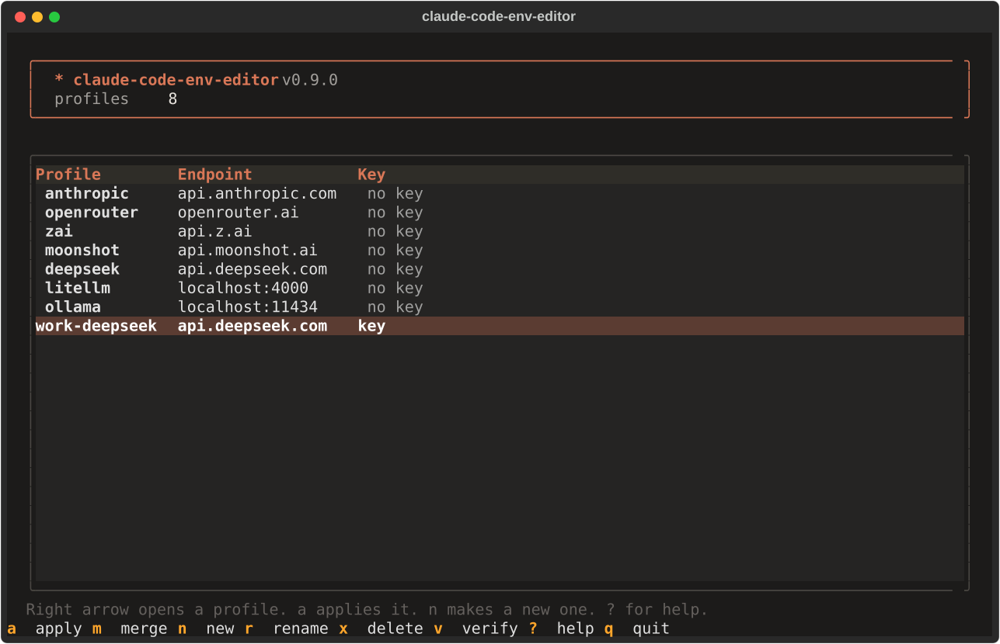
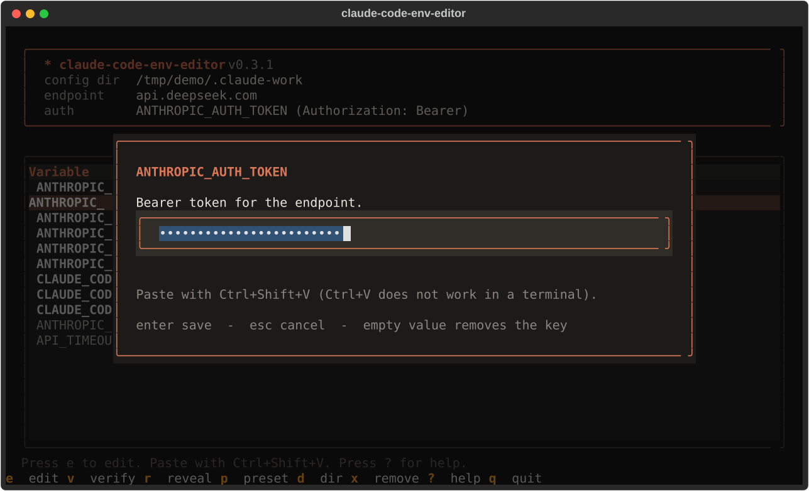
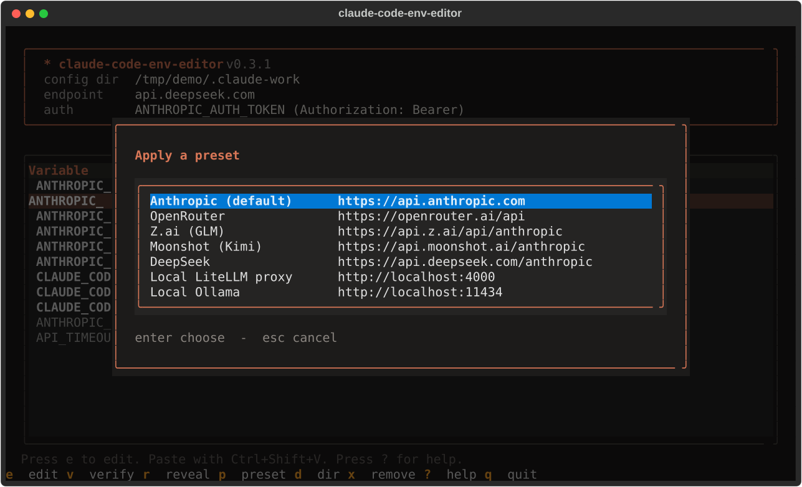
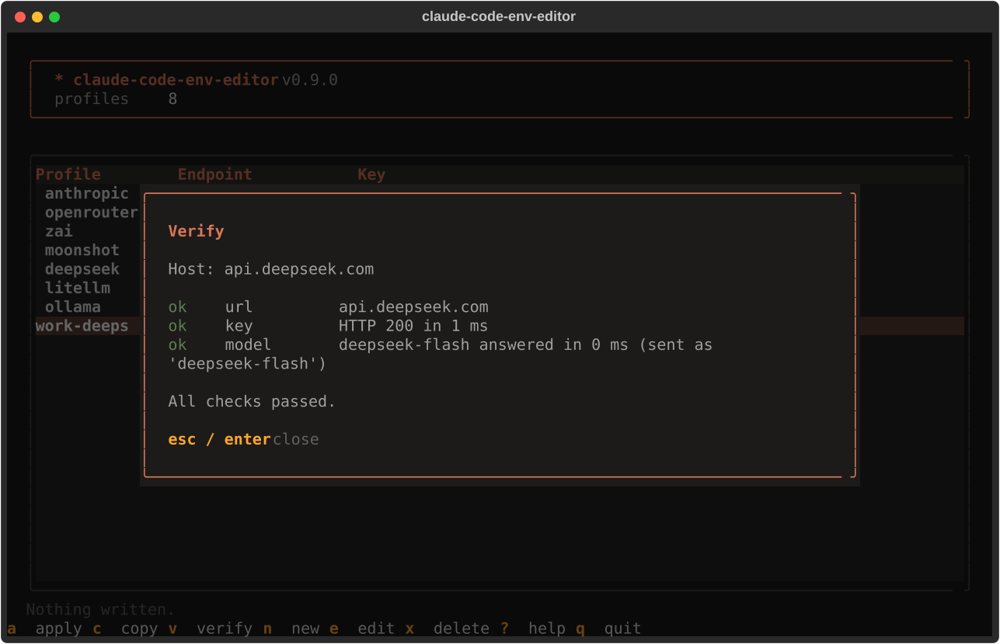
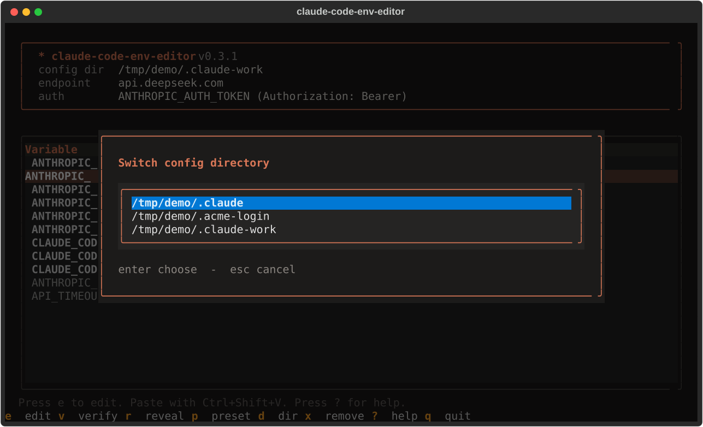
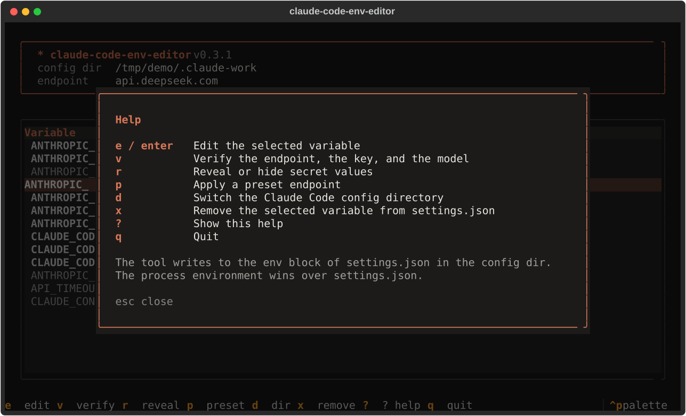

# claude-code-env-editor

A terminal UI to view, edit, and verify the Anthropic variables that Claude Code reads.
Point Claude Code at another endpoint without hand-editing JSON or shell files.

## Install

```sh
curl -LsSf https://raw.githubusercontent.com/kraigochieng/claude-code-env-editor/main/install.sh | sh
```

Install a chosen version:

```sh
curl -LsSf https://raw.githubusercontent.com/kraigochieng/claude-code-env-editor/main/install.sh | sh -s -- --version 0.2.0
```

Read [install.sh](install.sh) before you run it. It installs `uv` if needed, checks the SHA-256 of the
release wheel, then runs `uv tool install`. Linux and macOS are supported. On Windows use WSL.

Update: `claude-code-env-editor self-update [--version X.Y.Z]`. Remove: `claude-code-env-editor self-uninstall`.

## Use

```sh
claude-code-env-editor          # open the TUI
claude-code-env-editor show     # print variables, values, and sources
claude-code-env-editor preset deepseek
claude-code-env-editor set ANTHROPIC_AUTH_TOKEN      # asks for the secret
claude-code-env-editor verify
claude-code-env-editor export   # 'export NAME=value' lines
claude-code-env-editor help set
```

`cce` is a short alias. Inside the TUI press `?` for the key list.

| Key | Action |
|---|---|
| `e` / `enter` | Edit the selected variable |
| `v` | Verify the endpoint, the key, and the model |
| `r` | Reveal or hide secrets |
| `p` | Apply a preset |
| `d` | Switch config directory |
| `x` | Remove the variable |
| `?` | Help |
| `q` | Quit |

## Which key variable to set

The two secret variables use different HTTP headers. I tested this with Claude Code, a fake local server, and fake keys.

| Variable set | Header that Claude Code sends |
|---|---|
| `ANTHROPIC_API_KEY` only | `x-api-key: <value>` |
| `ANTHROPIC_AUTH_TOKEN` only | `Authorization: Bearer <value>` |
| Both | Both headers |

The endpoint decides which header it accepts. So the tool picks the variable from your base URL and shows only that one:

| Base URL | Variable shown |
|---|---|
| empty, or `api.anthropic.com` | `ANTHROPIC_API_KEY`, or no key when you use a Claude login |
| OpenRouter, Z.ai, Moonshot, DeepSeek, LiteLLM, Ollama (the presets) | `ANTHROPIC_AUTH_TOKEN` |
| any other URL | both variables |

A hidden variable stays visible when it has a value, with a warning in the banner. The mapping comes from provider guides. Check it for your provider. If a provider rejects one header, try the other variable.

## Screenshots

The screenshots use demo data: a made-up key and a made-up config directory. The verify page uses sample responses.

**Home.** Each variable with its value and source. Secrets show masked.



**Edit.** Press `e` on a variable to change it. An empty value removes the key.



**Presets.** Press `p` to fill the endpoint and the model names.



**Verify.** Press `v` to check the URL, the key, and the model name.



**Config directories.** Press `d` to switch between logins. The tool finds a directory by its content, so the name can be anything (`.acme-login`).



**Help.** Press `?` to list the keys.



## Variables

Run `claude-code-env-editor vars` for the full list: `ANTHROPIC_BASE_URL`, `ANTHROPIC_AUTH_TOKEN`,
`ANTHROPIC_API_KEY`, `ANTHROPIC_MODEL`, `ANTHROPIC_DEFAULT_{OPUS,SONNET,HAIKU}_MODEL`,
`CLAUDE_CODE_SUBAGENT_MODEL`, `CLAUDE_CODE_EFFORT_LEVEL`, `CLAUDE_CODE_AUTO_COMPACT_WINDOW`,
`ANTHROPIC_SMALL_FAST_MODEL`, `API_TIMEOUT_MS`, `CLAUDE_CONFIG_DIR`.
`CLAUDE_CODE_EFFORT_LEVEL` takes one of `low`, `medium`, `high`, `xhigh`, `max`, or `auto`. The TUI shows a list for it.
`CLAUDE_CODE_AUTO_COMPACT_WINDOW` takes a plain integer from 100000 to 1000000 (not `500k`). The tool rejects other values.
Other `ANTHROPIC_*` and `CLAUDE_CODE_*` keys in `settings.json` show as custom rows and are kept.

The tool reads two sources. The process environment wins over the `env` block of `settings.json`.
It writes only the `env` block. All other keys in the file stay as they were.

## Presets

`claude-code-env-editor preset` lists them: Anthropic, OpenRouter, Z.ai, Moonshot, DeepSeek,
LiteLLM, Ollama. **Check each URL and model name before you rely on it. Providers change them.**
The DeepSeek preset sets the base URL, all model aliases, the subagent model, the effort level, and the
compact window. It never sets a key.

## Several Claude Code logins

Each login lives in its own config directory. `CLAUDE_CONFIG_DIR` selects it, and each directory has its
own `settings.json` and its own `env` block. So each login can have its own endpoint.

Example with two logins. These aliases are in `~/.config/zsh/.zshrc`:

```sh
alias claude-work='export CLAUDE_CONFIG_DIR=~/.claude-work && claude'
alias claude-personal='export CLAUDE_CONFIG_DIR=~/.claude-personal && claude'
```

Each alias runs `export`, so `CLAUDE_CONFIG_DIR` stays set in your shell after `claude` exits.
The tool uses `$CLAUDE_CONFIG_DIR` as its default. So after `claude-work`, the tool edits the work login.
To edit another login, name its directory:

```sh
claude-code-env-editor --config-dir ~/.claude-personal show
claude-code-env-editor --config-dir ~/.claude-personal preset deepseek
```

The tool finds config directories from three sources. The name does not matter.
- The default: `$CLAUDE_CONFIG_DIR`, or `~/.claude`.
- The registry: directories you add with `claude-code-env-editor dirs add PATH`. The registry file is
  `dirs.toml` in the user config dir of your OS (`$XDG_CONFIG_HOME` on Linux, `~/Library/Application Support`
  on macOS, `%APPDATA%` on Windows).
- A scan: hidden directories in your home that hold `.claude.json`, or `settings.json` and a `projects` directory.

Run `claude-code-env-editor dirs` to list them. Inside the TUI press `d` to switch between them.

## Security

- Secrets (`ANTHROPIC_AUTH_TOKEN`, `ANTHROPIC_API_KEY`) show masked. The tool never logs them.
- `settings.json` is written atomically with mode `0600`. The old file stays as `settings.json.bak`.
- Claude Code reads keys from `settings.json` or the environment, so that is where the tool writes them.
  The tool keeps no second copy. Any program that runs as you can read the file. Keep the file private.
  Use `set --no-write-secret` to keep a key out of the file. The tool prints an `export` line instead.
- Verify sends requests only to your `ANTHROPIC_BASE_URL`, shows the host first, and never follows a
  redirect. It warns about `http://` URLs that are not local.
- Secrets are never read from command arguments, so they stay out of shell history.

## Verify

Verify runs three checks: the URL, `GET /v1/models` (proves the key), and a one-token
`POST /v1/messages` (proves the model name). A `[1m]` suffix is removed from the model name before the request.
A `404` on `/v1/models` is shown as `skip`, because some providers have no such route.

## Versions

Versions follow [Semantic Versioning](https://semver.org) and are computed from
[Conventional Commits](https://www.conventionalcommits.org). A change to the settings file handling that
breaks existing files is a breaking change. See the [releases](https://github.com/kraigochieng/claude-code-env-editor/releases).

## Develop

```sh
uv venv && uv pip install -e '.[dev]'
.venv/bin/python -m ruff check
.venv/bin/python -m mypy
.venv/bin/python -m pytest
```

Live tests send real requests (`max_tokens: 1`) to DeepSeek and OpenRouter. They are skipped by default and CI does not run them.
Set your own keys in the environment to run them. The keys are never written to a file.

```sh
CCEE_LIVE_DEEPSEEK_KEY=... CCEE_LIVE_OPENROUTER_KEY=... .venv/bin/python -m pytest -m live
```


## License

MIT. See [LICENSE](LICENSE).
