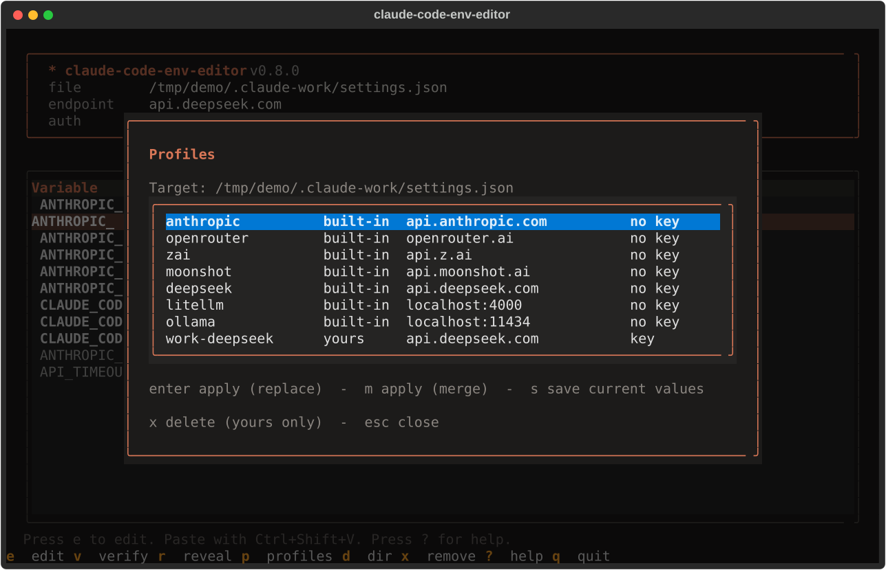
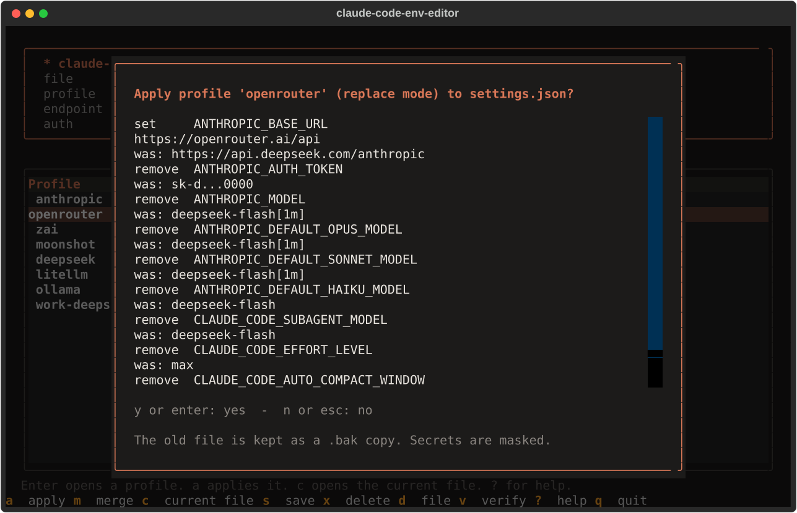

# claude-code-env-editor

A terminal UI to view, edit, verify, and switch the Anthropic variables that Claude Code reads.
Point Claude Code at another endpoint with one profile, without hand-editing JSON or shell files.

## What Claude Code already does

Use Claude Code itself for these. This tool does not replace them.

| Need | Claude Code feature |
|---|---|
| Switch the model | `/model` (picker or name), `--model`, `ANTHROPIC_MODEL`. `/model` saves your choice as the default. |
| Change theme, editor mode, verbosity | `/config` (a short list of options, not every key) |
| See which settings files loaded | `/status` (the `Setting sources` line) and `claude doctor` |

## What this tool adds

Claude Code has no menu for the `env` block of `settings.json`, and no command to test an endpoint.
This tool gives you:

- **Profiles.** One profile sets the base URL, the model aliases, the key, and the other variables together.
  Applying a profile removes the values of the previous endpoint, so no stale model name or key stays behind.
- **Verify.** It checks the URL, the key, and the model name before you start a session, and explains a failure.
- **The right key variable.** It shows `ANTHROPIC_AUTH_TOKEN` or `ANTHROPIC_API_KEY` based on the base URL.
- **Safe editing.** It validates values, masks secrets, and writes the file atomically with mode `0600`.
- **Several logins.** It finds and switches config directories.

Do not use this tool only to switch the model. `/model` does that better.

## What this tool does not see

The tool edits the user `settings.json` of one config directory. Claude Code also reads higher levels:
managed settings, the `--settings` flag, `.claude/settings.local.json`, and `.claude/settings.json` in a project.
A value there can override your `env` block, and this tool cannot see it. Run `/status` in Claude Code to see
which files loaded.

## Install

```sh
curl -LsSf https://raw.githubusercontent.com/kraigochieng/claude-code-env-editor/main/install.sh | sh
```

Install a chosen version:

```sh
curl -LsSf https://raw.githubusercontent.com/kraigochieng/claude-code-env-editor/main/install.sh | sh -s -- --version 0.2.0
```

Read [install.sh](install.sh) before you run it. It installs `uv` if needed, checks the SHA-256 of the
release wheel, then runs `uv tool install`. Linux and macOS are supported. On Windows use WSL.

Update: `claude-code-env-editor self-update [--version X.Y.Z]`. Remove: `claude-code-env-editor self-uninstall`.

## Use

```sh
claude-code-env-editor          # open the TUI
claude-code-env-editor show     # print variables, values, and sources
claude-code-env-editor preset deepseek
claude-code-env-editor set ANTHROPIC_AUTH_TOKEN      # asks for the secret
claude-code-env-editor verify
claude-code-env-editor export   # 'export NAME=value' lines
claude-code-env-editor help set
```

`cce` is a short alias. Inside the TUI press `?` for the key list.

**Paste a key with `Ctrl+Shift+V`.** A terminal does not use `Ctrl+V`. On macOS use `Cmd+V`. This works in the value box of the edit dialog.

| Key | Action |
|---|---|
| `e` / `enter` | Edit the selected variable |
| `v` | Verify the endpoint, the key, and the model |
| `r` | Reveal or hide secrets |
| `p` | Profiles: apply, save the current values, delete |
| `d` | Switch config directory, or open another settings file |
| `x` | Remove the variable (asks first) |
| `?` | Help |
| `q` | Quit |

## Profiles

A profile is a name and a set of known variables, for example the base URL, the model aliases, and the key.
Built-in profiles come from the presets and are read-only. Your own profiles live in `profiles.toml`
in the config directory of this tool (`dirs.toml` is there too).

```sh
claude-code-env-editor profile                      # list built-in profiles and yours
claude-code-env-editor profile show deepseek        # print the variables (keys masked, --reveal shows them)
claude-code-env-editor profile save work-ds         # save the current values of the target
claude-code-env-editor profile save mine --from deepseek --note "my copy"
claude-code-env-editor profile save shared --no-key # leave the key out
claude-code-env-editor profile delete work-ds       # asks first, or use --yes
```

### Apply a profile

```sh
claude-code-env-editor profile apply deepseek                  # to the default config directory
claude-code-env-editor profile apply deepseek --config-dir ~/.claude-work
claude-code-env-editor profile apply deepseek --file .claude/settings.local.json   # any settings file
claude-code-env-editor profile apply deepseek --dry-run        # show the changes, write nothing
```

`apply` shows what it changes and asks before it writes (`--yes` skips the question).

- **Replace mode (default).** It sets every variable of the profile and removes every known variable that the
  profile does not list. So no model name or key of the previous endpoint stays behind. I tested this with Claude
  Code: after a replace, a removed `ANTHROPIC_MODEL` is gone and Claude Code uses its default model.
- **A key stays when the endpoint host does not change**, because it goes to the same place. A key is removed when
  the host changes, so it never goes to another provider.
- **`--merge`** changes only the listed variables. Old values stay. The tool warns when a key would go to a new host.
- **Custom variables** in the `env` block are never touched.
- **Keys in a shared file.** A profile with a key is refused for a file that may be committed, for example
  `.claude/settings.json` of a project. Use `.claude/settings.local.json` or a config directory. The option
  `--allow-secret-in-shared-file` overrides this.
- The old file is kept as `settings.json.bak`, next to the settings file.
- `preset NAME` still works. It runs `profile apply NAME --merge --yes`, as before.

### Profiles in the TUI

Press `p` for the profile list. The list names the target file at the top.

| Key | Action |
|---|---|
| `enter` | Apply in replace mode. A dialog first shows every change, with secrets masked. |
| `m` | Apply in merge mode |
| `s` | Save the current values as a new profile. The tool asks for a name and, when a key is set, asks if the key goes into the profile. |
| `x` | Delete one of your profiles (asks first) |

A profile with a key is refused for a file that may be committed. The dialog says why.
The CLI option `--allow-secret-in-shared-file` is the only way to override that.

### Manage profiles

- A name has letters, digits, `.`, `-`, and `_`. A built-in name cannot be replaced.
- Only variables that the tool knows are allowed. A profiles file cannot set `PATH` or `LD_PRELOAD`.
- **A profile can hold a key.** `profiles.toml` is written with mode `0600`, in a directory with mode `0700`,
  and a `.gitignore` lists it. It is a second plaintext copy of the key, as exposed as `settings.json`.
  Do not commit or share this file. Use `--no-key` for a profile that you want to share.
- A broken `profiles.toml` gives an error. The tool never overwrites a file that it cannot read.

## Which key variable to set

The two secret variables use different HTTP headers. I tested this with Claude Code, a fake local server, and fake keys.

| Variable set | Header that Claude Code sends |
|---|---|
| `ANTHROPIC_API_KEY` only | `x-api-key: <value>` |
| `ANTHROPIC_AUTH_TOKEN` only | `Authorization: Bearer <value>` |
| Both | Both headers |

The endpoint decides which header it accepts. So the tool picks the variable from your base URL and shows only that one:

| Base URL | Variable shown |
|---|---|
| empty, or `api.anthropic.com` | `ANTHROPIC_API_KEY`, or no key when you use a Claude login |
| OpenRouter, Z.ai, Moonshot, DeepSeek, LiteLLM, Ollama (the presets) | `ANTHROPIC_AUTH_TOKEN` |
| any other URL | both variables |

A hidden variable stays visible when it has a value, with a warning in the banner. The mapping comes from provider guides. Check it for your provider. If a provider rejects one header, try the other variable.

## Screenshots

The screenshots use demo data: a made-up key and a made-up config directory. The verify page uses sample responses.

**Home.** Each variable with its value and source. Secrets show masked.


**Edit.** Press `e` on a variable to change it. Paste with `Ctrl+Shift+V`. An empty value removes the key.


**Profiles.** Press `p` to apply a profile, save the current values, or delete a profile.



**Apply.** Enter shows every change before it writes. Secrets are masked. A key of another endpoint is removed.



**Verify.** Press `v` to check the URL, the key, and the model name.


**Config directories.** Press `d` to switch between logins. The tool finds a directory by its content, so the name can be anything (`.acme-login`).


**Help.** Press `?` to list the keys.


## Variables

Run `claude-code-env-editor vars` for the full list: `ANTHROPIC_BASE_URL`, `ANTHROPIC_AUTH_TOKEN`,
`ANTHROPIC_API_KEY`, `ANTHROPIC_MODEL`, `ANTHROPIC_DEFAULT_{OPUS,SONNET,HAIKU}_MODEL`,
`CLAUDE_CODE_SUBAGENT_MODEL`, `CLAUDE_CODE_EFFORT_LEVEL`, `CLAUDE_CODE_AUTO_COMPACT_WINDOW`,
`ANTHROPIC_SMALL_FAST_MODEL`, `API_TIMEOUT_MS`.
`CLAUDE_CODE_EFFORT_LEVEL` takes one of `low`, `medium`, `high`, `xhigh`, `max`, or `auto`. The TUI shows a list for it.
`CLAUDE_CODE_AUTO_COMPACT_WINDOW` takes a plain integer from 100000 to 1000000 (not `500k`). The tool rejects other values.
Other `ANTHROPIC_*` and `CLAUDE_CODE_*` keys in `settings.json` show as custom rows and are kept.

The tool reads two sources. The `env` block of `settings.json` wins over your shell. I tested this with Claude Code: a model
in the `env` block overrides `ANTHROPIC_MODEL` exported in the shell. When the shell holds a different value, the table
shows `settings (shell differs)`. Claude Code ignores the shell value.
It writes only the `env` block. All other keys in the file stay as they were.

## Built-in profiles

`claude-code-env-editor profile` lists them: Anthropic, OpenRouter, Z.ai, Moonshot, DeepSeek,
LiteLLM, Ollama. **Check each URL and model name before you rely on it. Providers change them.**
The DeepSeek profile sets the base URL, all model aliases, the subagent model, the effort level, and the
compact window. A built-in profile never holds a key. The older `preset` command is an alias that merges.

## Several Claude Code logins

Each login lives in its own config directory. `CLAUDE_CONFIG_DIR` selects it, and each directory has its
own `settings.json` and its own `env` block. So each login can have its own endpoint.

Example with two logins. These aliases are in `~/.config/zsh/.zshrc`:

```sh
alias claude-work='export CLAUDE_CONFIG_DIR=~/.claude-work && claude'
alias claude-personal='export CLAUDE_CONFIG_DIR=~/.claude-personal && claude'
```

Each alias runs `export`, so `CLAUDE_CONFIG_DIR` stays set in your shell after `claude` exits.
The tool uses `$CLAUDE_CONFIG_DIR` as its default. So after `claude-work`, the tool edits the work login.
To edit another login, name its directory:

```sh
claude-code-env-editor --config-dir ~/.claude-personal show
claude-code-env-editor --config-dir ~/.claude-personal profile apply deepseek
```

The tool finds config directories from three sources. The name does not matter.
- The default: `$CLAUDE_CONFIG_DIR`, or `~/.claude`.
- The registry: directories you add with `claude-code-env-editor dirs add PATH`. The registry file is
  `dirs.toml` in the user config dir of your OS (`$XDG_CONFIG_HOME` on Linux, `~/Library/Application Support`
  on macOS, `%APPDATA%` on Windows).
- A scan: hidden directories in your home that hold `.claude.json`, or `settings.json` and a `projects` directory.

Run `claude-code-env-editor dirs` to list them. Inside the TUI press `d` to switch between them, or to type the path of any
settings file (for example `.claude/settings.local.json` of a project). `claude-code-env-editor tui --file PATH` opens one directly.

## Security

- Secrets (`ANTHROPIC_AUTH_TOKEN`, `ANTHROPIC_API_KEY`) show masked. The tool never logs them.
- `settings.json` is written atomically with mode `0600`. The old file stays as `settings.json.bak`.
- Claude Code reads keys from `settings.json` or the environment, so that is where the tool writes them.
  Any program that runs as you can read the file. Keep the file private.
  Use `set --no-write-secret` to keep a key out of the file. The tool prints an `export` line instead.
- A profile can hold a copy of a key in `profiles.toml` (mode `0600`, `.gitignore` next to it). Leave the key out
  with `profile save --no-key` or the TUI question. A profile with a key is never written to a file that may be committed.
- Verify sends requests only to your `ANTHROPIC_BASE_URL`, shows the host first, and never follows a
  redirect. It warns about `http://` URLs that are not local.
- Secrets are never read from command arguments, so they stay out of shell history.

## Verify

Verify runs three checks: the URL, `GET /v1/models` (proves the key), and a one-token
`POST /v1/messages` (proves the model name). A `[1m]` suffix is removed from the model name before the request.
A `404` on `/v1/models` is shown as `skip`, because some providers have no such route.

## Versions

Versions follow [Semantic Versioning](https://semver.org) and are computed from
[Conventional Commits](https://www.conventionalcommits.org). A change to the settings file handling that
breaks existing files is a breaking change. See the [releases](https://github.com/kraigochieng/claude-code-env-editor/releases).

## Develop

```sh
uv venv && uv pip install -e '.[dev]'
.venv/bin/python -m ruff check
.venv/bin/python -m mypy
.venv/bin/python -m pytest
```

Live tests send real requests (`max_tokens: 1`) to DeepSeek and OpenRouter. They are skipped by default and CI does not run them.
Set your own keys in the environment to run them. The keys are never written to a file.

```sh
CCEE_LIVE_DEEPSEEK_KEY=... CCEE_LIVE_OPENROUTER_KEY=... .venv/bin/python -m pytest -m live
```


## License

MIT. See [LICENSE](LICENSE).
